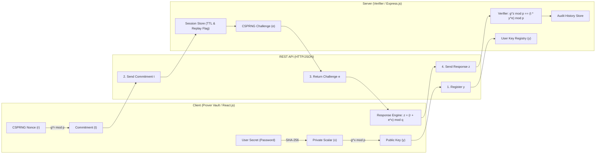
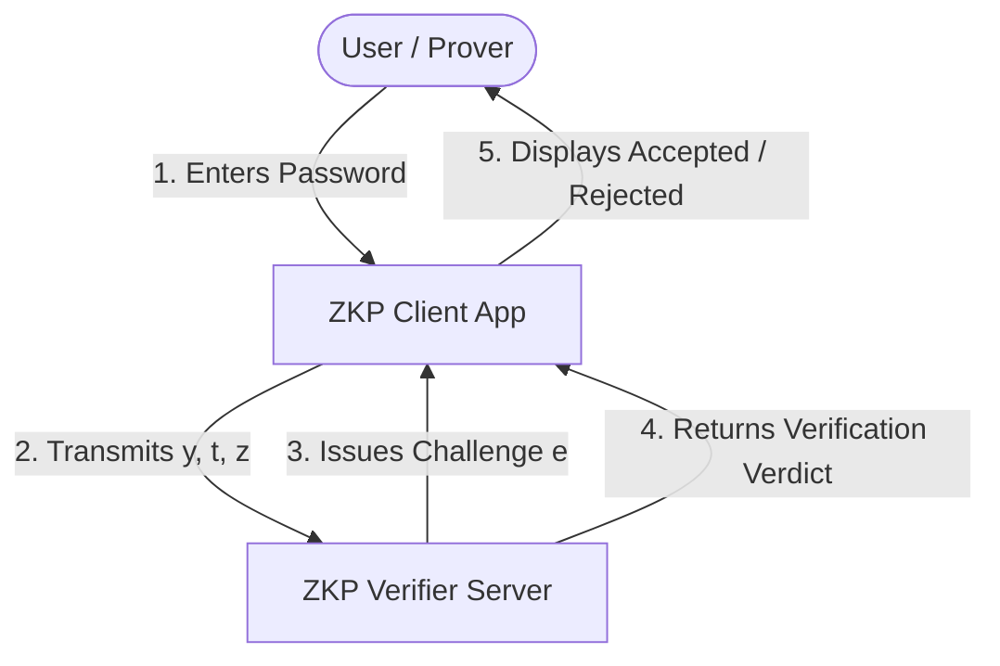
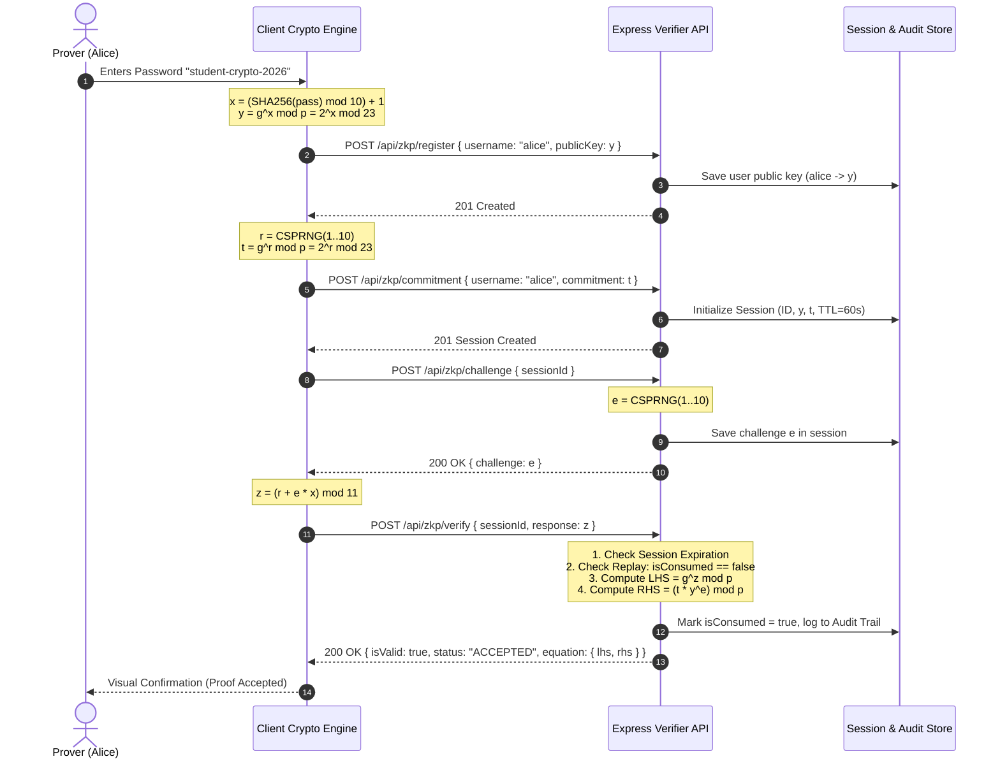

# System Architecture Specification

## Zero Knowledge Proof (Schnorr) Authentication System

### 1. Architectural Overview

The application follows a client-server distributed architecture designed to uphold the fundamental zero-knowledge property: **the prover's private secret witness ($x$) and ephemeral nonce ($r$) never cross the network boundary**.

---

### 2. Component Identification & Separation of Duties

| Component | Host / Environment | Primary Responsibility | Data Retained | Never Disclosed |
| :--- | :--- | :--- | :--- | :--- |
| **Prover Engine** | Client Browser (`React.js`) | Derives scalar $x$ from password, generates random nonce $r$, computes commitment $t = g^r \pmod p$, computes response $z = (r + e \cdot x) \pmod q$. | Secret $x$, Nonce $r$, Public Key $y$, Session Token | $x$ (witness), $r$ (ephemeral nonce) |
| **Network Layer** | HTTP / JSON REST API | Carries public registration and verification messages. | Transmitted packet payloads ($y, t, e, z$) | Raw secrets or unmasked nonces |
| **Challenge Dispenser** | Express Backend (`Node.js`) | Generates cryptographically secure challenge $e \in [1, q-1]$, tracks session TTL (60s), sets replay prevention flags. | Active sessions, TTL timestamps, `isConsumed` flag | N/A |
| **Verification Engine** | Express Backend (`Node.js`) | Calculates $LHS = g^z \pmod p$ and $RHS = (t \cdot y^e) \pmod p$, enforces equality check, returns ACCEPTED / REJECTED. | Session outcome, timing latency | N/A |
| **Audit Logger** | In-Memory / Persistence | Records session ID, timestamp, public parameters, LHS, RHS, verification verdict, and latency. | Non-sensitive public metadata | Plaintext passwords, witnesses, nonces |

---

### 3. Data Flow Diagrams (DFD)

#### 3.1 DFD Level 0 (Context Diagram)

#### 3.2 DFD Level 1 (Detailed Subsystem Flow)

---

### 4. Security Boundaries & Threat Model

1. **Passive Eavesdropper (Network Sniffer):**
   - Intercepts $y, t, e, z$.
   - **Defense:** Finding $x$ from $y = g^x \pmod p$ requires solving DLP. Finding $x$ from $z = (r + e \cdot x) \pmod q$ is impossible because $r$ acts as a one-time pad mask.

2. **Active Impostor (Cheating Prover):**
   - Attempts to authenticate without knowing $x$.
   - **Defense:** By the Special Soundness property, a prover who can pass two different challenges $e_1 \ne e_2$ for the same commitment $t$ must know $x$. Without $x$, probability of guessing valid $z$ is $1/q = 1/11 \approx 9\%$ in demo ($2^{-256}$ in production).

3. **Replay Attacker:**
   - Eavesdrops valid proof transcript $(t, e, z)$ and resubmits it.
   - **Defense:** Every session is single-use. The `isConsumed` guard invalidates the session token immediately upon first check.

4. **Compromised Server Database:**
   - Server database stores only usernames and public keys ($y$).
   - **Defense:** No plaintext passwords or password hashes exist on the server to crack offline.

